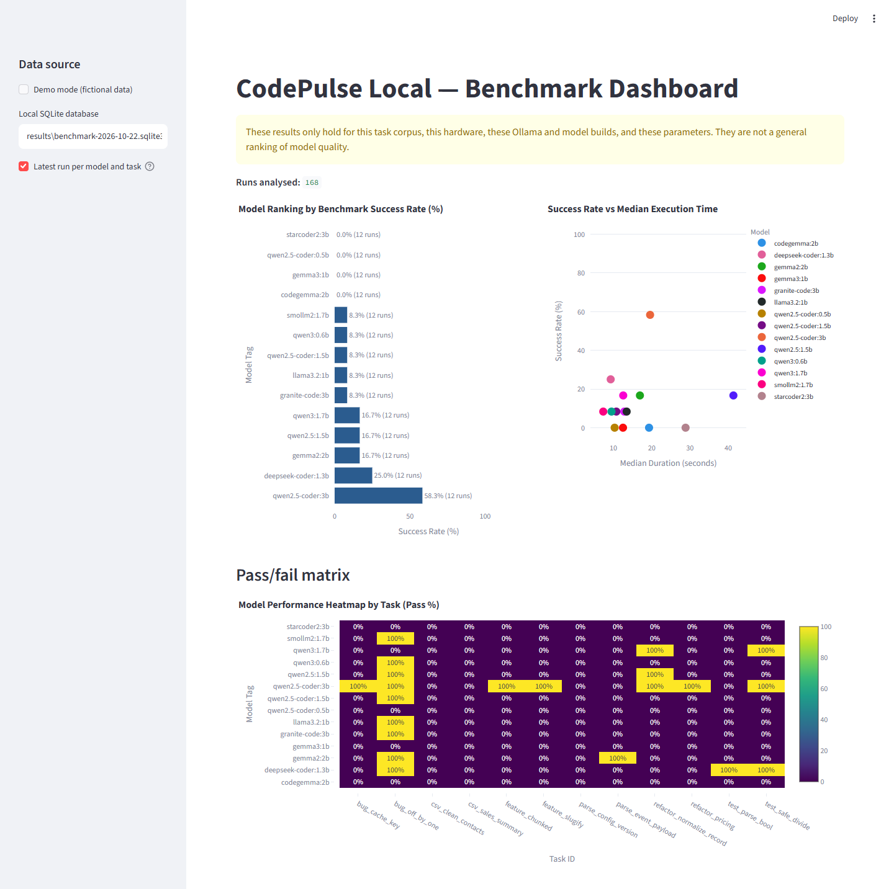
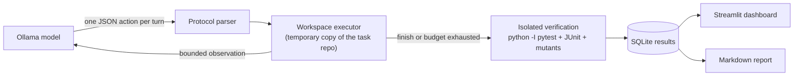

# CodePulse Local

[](https://github.com/ktubi970/CodePulse/actions/workflows/ci.yml)

[](LICENSE)

A reproducible, fully local benchmark for **small language models (0.5B–3B) acting as coding
agents**. Each model gets a small broken Python repository, a strict JSON action protocol and a
turn budget; success is decided by an isolated, hidden `pytest` run that the model cannot fake.

Everything runs offline against a local [Ollama](https://ollama.com) server: no API keys, no
telemetry, no model downloads triggered by the harness.

> **Scope:** results hold only for this task corpus, this hardware, these Ollama/model builds and
> these budget parameters. They are not a general ranking of model quality.

## Results



14 local models (0.5B–3B), 12 tasks, one run each at temperature 0, 12 turns, 8192-token context
(Ollama 0.40.8, RTX 2070 8 GB, October 2026):

| Rank | Model | Solved | Success rate | Median run time |
|---:|---|---:|---:|---:|
| 1 | `qwen2.5-coder:3b` | 7/12 | 58% | 19.6 s |
| 2 | `deepseek-coder:1.3b` | 3/12 | 25% | 9.3 s |
| 3 | `qwen3:1.7b` | 2/12 | 17% | 12.6 s |
| 4 | `gemma2:2b` | 2/12 | 17% | 16.9 s |
| 5 | `qwen2.5:1.5b` | 2/12 | 17% | 41.4 s |
| 6 | `smollm2:1.7b` | 1/12 | 8% | 7.4 s |
| 7 | `qwen3:0.6b` | 1/12 | 8% | 9.5 s |
| 8 | `qwen2.5-coder:1.5b` | 1/12 | 8% | 10.8 s |
| 9 | `granite-code:3b` | 1/12 | 8% | 12.9 s |
| 10 | `llama3.2:1b` | 1/12 | 8% | 13.5 s |
| 11 | `qwen2.5-coder:0.5b` | 0/12 | 0% | 10.3 s |
| 12 | `gemma3:1b` | 0/12 | 0% | 12.5 s |
| 13 | `codegemma:2b` | 0/12 | 0% | 19.3 s |
| 14 | `starcoder2:3b` | 0/12 | 0% | 28.9 s |

What the numbers say:

- Only `qwen2.5-coder:3b` solves more than a quarter of the corpus. Size is not the whole story:
  `deepseek-coder:1.3b` comes second, ahead of every 2B–3B model except `qwen2.5-coder:3b`.
- The two base code-completion models score 0, for different reasons: 36% of `starcoder2:3b`'s
  replies were invalid actions and it never edited a file, while `codegemma:2b` followed the
  protocol but none of its 12 edits passed the tests.
- `bug_off_by_one` is solved by 9 models; the two CSV tasks and `parse_config_version` by none.
- Whole-file edits are the only edits these models manage to apply: 181 accepted `write_file`
  actions, 0 valid unified diffs.

Full per-task matrix and failure modes: [docs/results.md](docs/results.md).
Reproduce with `codepulse batch` then `codepulse report` (see [Quick start](#quick-start)).

## What building this taught me

The first version of the harness ran **218 runs over 14 models and recorded 0 successes**.
The models were not the problem; the harness was:

| Symptom | Root cause | Fix |
|---|---|---|
| 168 runs failed before any test ran | Tests ran with user site-packages disabled, where `pytest` was installed | A pre-flight check that refuses to start, with an explicit message |
| 0 of 352 patches applied | Sub-3B models cannot write byte-exact unified diffs | A `write_file` action (whole-file replacement) |
| 404 replies rejected as protocol errors | The JSON schema sent to Ollama allowed fields that the parser rejected | Parser accepts everything the schema allows (256 of the 404 replies become valid) |
| One task unsolvable by any model | Its hidden test file was a single line with literal `\n` (a `SyntaxError`) | A reference solution per task, checked in CI |
| A one-line `sitecustomize.py` made any task "pass" | The model's repository was on `PYTHONPATH` when pytest started | `python -I`, `--noconftest`, and a mandatory clean JUnit report |

The lesson: before comparing models, prove the benchmark can be passed (reference solutions)
and cannot be gamed (adversarial tests in
[`tests/test_verification_integrity.py`](tests/test_verification_integrity.py)).

## How it works



Each turn, the model answers with exactly one JSON object. Ollama's structured outputs constrain
the reply to the action schema, so models without native tool calling can take part.

```json
{"action": "list_files"}
{"action": "read_file", "path": "src/window.py"}
{"action": "write_file", "path": "src/window.py", "content": "def window(values, start, width):\n    ..."}
{"action": "apply_patch", "patch": "--- a/src/window.py\n+++ b/src/window.py\n@@ ..."}
{"action": "run_tests"}
{"action": "finish", "summary": "Fixed the slice upper bound."}
```

### Verification

A run succeeds only if all of these hold after the last turn:

- a fresh `python -I -B -m pytest --noconftest -p no:cacheprovider` run over the visible tests and
  the **hidden** verification tests exits with code 0;
- its JUnit report shows at least one test and no failure, error or skip (exit code 0 alone is not
  trusted: code under test can call `os._exit(0)`);
- for test-writing tasks, the agent's tests fail on every **mutant** shipped with the task (an
  emptied test is reported as `weak_tests`).

### Task corpus

Twelve small synthetic tasks, two per category. Each ships a hidden verification suite and a
reference solution; `codepulse validate-tasks` (also run in CI) proves that every initial state
fails and every reference solution passes.

| Category | Tasks |
|---|---|
| Fix a bug | `bug_off_by_one`, `bug_cache_key` |
| Add a function | `feature_slugify`, `feature_chunked` |
| Write a test | `test_parse_bool`, `test_safe_divide` |
| Refactor | `refactor_pricing`, `refactor_normalize_record` |
| CSV processing | `csv_clean_contacts`, `csv_sales_summary` |
| Schema parsing | `parse_config_version`, `parse_event_payload` |

Format: [docs/task-format.md](docs/task-format.md). Stored results: [docs/result-format.md](docs/result-format.md).

## Quick start

Requirements: Python 3.12+, Git, and [Ollama](https://ollama.com) running locally with the models
listed in [`codepulse.toml`](codepulse.toml) already pulled (the harness never pulls models).

Use a virtual environment: tests run in isolated mode (`python -I`), which ignores user
site-packages, so a `pip install --user` pytest is invisible to the harness. The CLI checks this
and stops with an explicit error.

```bash
python -m venv .venv
source .venv/bin/activate        # Windows: .venv\Scripts\Activate.ps1
pip install -e ".[test]"
```

```bash
codepulse list-models                                     # models installed in Ollama
codepulse validate-tasks                                  # corpus integrity check
codepulse run --model qwen2.5-coder:3b --task bug_off_by_one
codepulse batch                                           # every configured model x task
codepulse report --output docs/results.md                 # Markdown leaderboard
codepulse show-runs --limit 20
```

Dashboard (rankings, success vs. time, pass/fail matrix, and every run's actions, final diff and
pytest output):

```bash
streamlit run dashboard/app.py                            # reads results/codepulse.sqlite3
CODEPULSE_DB=results/other.sqlite3 streamlit run dashboard/app.py
CODEPULSE_DEMO=1 streamlit run dashboard/app.py           # fictional demo data, no Ollama needed
```

Budgets (turns, context, timeouts, seed, temperature) live in [`codepulse.toml`](codepulse.toml)
and are recorded with every run, together with the model digest and Ollama version.

## Project layout

```text
agent/        protocol parser, prompts, Ollama client, workspace executor, agent loop
runner/       CLI, configuration, task manifests, SQLite storage, Markdown report
dashboard/    Streamlit app and Plotly charts
tasks/        12 tasks: repo/ (given to the model), verification/ (hidden), solution/, mutants/
tests/        harness tests, including adversarial verification tests
docs/         task and result formats, benchmark results, original design notes
```

## Development

```bash
pip install -e ".[dev]"
pytest                     # 131 tests, about 2 minutes
ruff check .
```

CI runs lint, the corpus check and the full test suite on Ubuntu and Windows with Python 3.12 and 3.13.

## Security and limitations

- **Local only:** the Ollama client rejects non-loopback URLs and has no code path for
  `/api/pull`, telemetry or uploads.
- **Confined file actions:** paths are resolved inside a temporary copy of the task repository;
  absolute paths, `..`, drive letters and alternate data streams are rejected.
- **Not a sandbox:** the code a model writes is executed by pytest with your user privileges. The
  verification hardening stops accidental and trivial bypasses, not a deliberately malicious model
  (for example one that loads a pytest plugin from its own test files). Run untrusted models in a
  container or VM.
- **Small sample:** 12 tasks with one run per model and task at temperature 0. A one-task difference
  is about 8 percentage points; treat close scores as ties.

## License

MIT — see [LICENSE](LICENSE). Model weights keep their own licenses.
